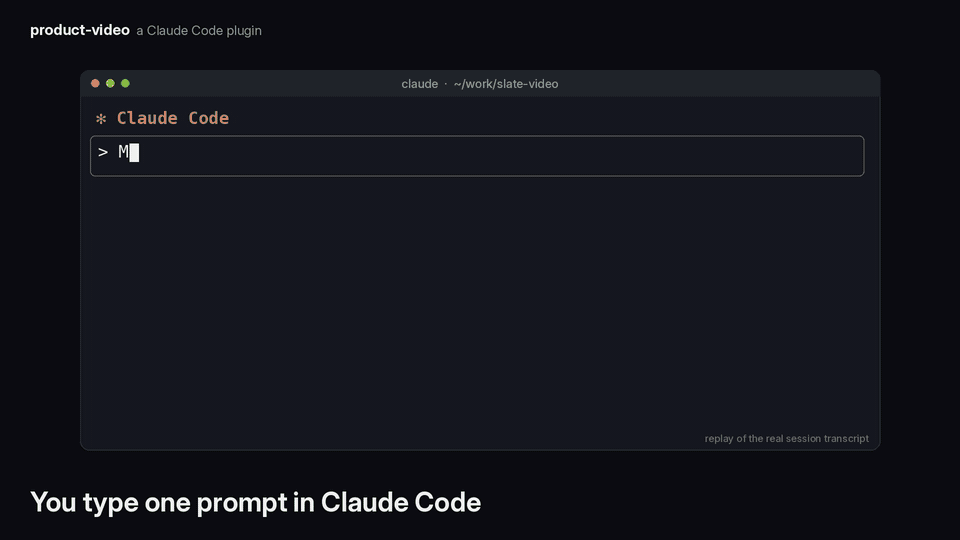
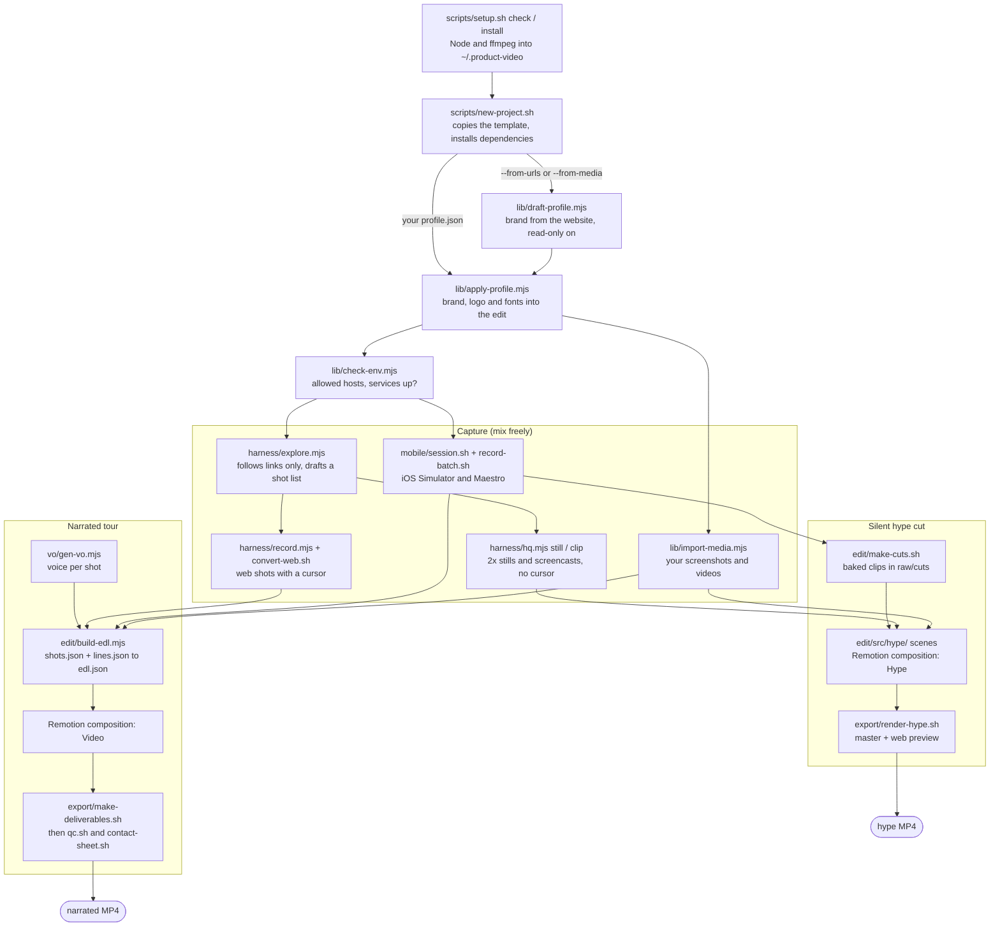

# product-video

**A Claude Code plugin that turns your own web or mobile app into a branded product video: it
records the app look-only (or uses your screenshots) and edits the result in Remotion.**

[](docs/media/product-video-demo.mp4)

<sub>A 13 s loop from the [51 s demo (MP4)](docs/media/product-video-demo.mp4). It shows a real run
against the public slategolfapps.com marketing site. The terminal panels replay that session's
transcript; they are not a screen recording.</sub>

## What you get

Both come out as a 1920x1080, 30 fps H.264 MP4 in your brand: the logo, colours and fonts from the
profile, which Claude can draft from your website.

| | Narrated tour | Silent hype cut |
| --- | --- | --- |
| **For** | Feature walkthroughs, onboarding, demos | Launches and promos |
| **Looks like** | Title card, one scene per feature with zooms and callouts, burned-in captions, end card | Type and product on a dark stage, words landing on the beat, a floating phone or browser, logo card |
| **Sound** | A voice track: the Mac's voice, your own text-to-speech command, or your recorded lines | None. Cut on a beat grid so music can be added later |
| **Length** | Set by the script | 30 to 60 seconds |
| **Files** | A delivery MP4 (two-pass, loudness-normalised) and a master | A master for an editor (Rec. 709) and a smaller web preview |

Recorded shots, your own screenshots and your own screen recordings can be mixed in one video.

## Quick start

### Option A: the Claude desktop app (no terminal)

You need the Claude desktop app on a Mac, signed in.

1. Open Claude, click the **Code** tab, and start a new session in any folder (Documents is fine).
2. Paste this and send it:

   ```text
   Please install the product-video plugin for me. Run these two commands:
   claude plugin marketplace add trev91/product-video
   claude plugin install product-video@product-video
   If "claude" is not found, use the newest claude program inside
   ~/Library/Application Support/Claude/claude-code instead.
   Tell me when it is installed.
   ```

   If Claude asks permission to run a command, click **Allow**. If a pop-up offers to install
   "command line developer tools", click **Install**, wait, then send the message again.
3. When it says it is installed, start a **new session**, then type `set up video making`. Claude
   checks your Mac and, with your OK, installs anything missing (a few minutes, about 250 MB).
4. Ask for a video in one of two ways:
   - **From your live app.** Claude records it in look-only mode.

     ```text
     Make a product video. Brand from https://example.com, app at https://app.example.com
     ```

   - **From your own screenshots or screen recordings.** Attach them or name the folder. Nothing
     is recorded and Claude never opens your app.

     ```text
     Make a product video from my screenshots. Brand from https://example.com. The files are in my Downloads folder, in "video screenshots".
     ```

   You can combine the two: record what Claude can reach and supply screenshots for the rest.

**Tips for screenshots:** capture just the app, without the address bar or desktop; check that no
real names, emails or phone numbers show (or tell Claude what to cover); and send a short screen
recording wherever the clicking or typing matters, because a screenshot shows no motion.

### Option B: a terminal

```bash
claude plugin marketplace add trev91/product-video
claude plugin install product-video@product-video
```

Start a new session so the plugin loads, then run `/product-video:setup` (or say "set up video
making"). To update later: `claude plugin marketplace update product-video`, then
`claude plugin update product-video@product-video`.

### First video

1. Give Claude your public website (for the brand) and your web app's address (to record). It
   drafts a profile with read-only mode on and goes through it with you. If the app needs a login,
   you sign in once in a browser window it opens; it never sees the password. Check the
   `environment` and `safety` sections: they decide where recording is allowed and what must never
   happen. To write the profile yourself, start from
   [`profile.example.json`](skills/product-video/assets/template/profile.example.json).
2. Ask for the video: "make a 60 second hype video of the new dashboard" or "make a narrated tour
   of onboarding". Claude agrees the shot list with you before it records anything.

## How it works

Everything specific to your organization lives in one profile file: brand, the apps to record,
the environment where recording is safe, and creative decisions already settled. The engine is a
project template that `new-project.sh` copies for each video. Paths below are inside that project,
except `scripts/`, which is in [`skills/product-video/`](skills/product-video/).



Before any full render, `edit/stills.mjs` renders single frames for review. Every web capture goes
through `harness/lib.mjs`, which refuses hosts outside the profile and, in read-only mode, aborts
every request that is not a read. The skill itself ([`SKILL.md`](skills/product-video/SKILL.md))
tells Claude the order of these steps; the [pipeline reference](skills/product-video/references/pipeline.md)
has the file formats and gotchas.

## Requirements

- **macOS**, or **Linux for web videos** (tried on Debian 13, x86-64): the profile draft, the web
  recorder and the hype-cut render work there. Mobile capture and the `system` voice (macOS `say`)
  do not; use `narration.mode` `command`, `recorded` or `silent` on Linux.
- **Node 20+ and ffmpeg with libx264.** Setup installs them into `~/.product-video` if missing,
  with no administrator password; delete that folder to undo it. Google Chrome is used when
  present, otherwise the first project downloads a private Chromium (about 150 MB).
- **About 1 GB per project** for its dependencies, plus a headless browser for the first render.
- **Mobile capture only:** macOS with Xcode's iOS Simulator and Maestro. Web-only use needs neither.
- **Remotion licence:** the edit is built with Remotion, which is free for individuals and
  companies of up to three people. Larger organizations need a paid Remotion company licence.

## What it will not do

- **Record outside the profile.** It refuses any host the profile does not allow and any request
  the profile blocks.
- **Change a live app.** A live app is recorded read-only: every request that is not a read is
  aborted. WebSocket messages are not covered, so it does not type into chat, comment or
  collaborative fields. Forms are shown filled in, never submitted.
- **Handle passwords.** You sign in yourself in a browser window; the profile names environment
  variables and their values are never read, printed or written to a file.
- **Show what the profile masks.** Anything listed in `safety.mask` (names, emails, phone numbers)
  is covered or left out, and supplied screenshots are checked for it.
- **Fake the product.** Supplied media is used as given: no invented screens, no mock-ups passed
  off as the real app.
- **Upload, post or commit** a video unless you ask.

## Status

Version 0.2.0: the engine, the profile schema, a start from two URLs, and videos made from supplied
screenshots and videos. The template renders and the web recorder runs end to end against a test
page. It has not yet been run on a second organization's product, the mobile scripts are untested
outside the product they came from, and mobile capture is iOS Simulator only.

## Licence

MIT. See [LICENSE](LICENSE). Remotion, which the edit depends on, has its own licence (see
[Requirements](#requirements)).
